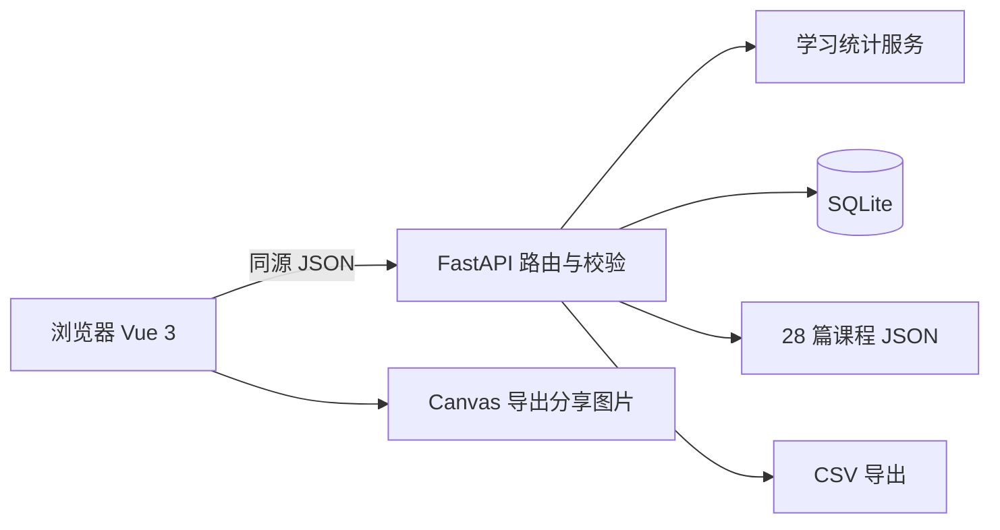

# 架构设计

`frontend/index.html`、`app.js`、`styles.css` 组成 Vue 单页面应用。官方 Vue 生产版文件放在 `vendor/`，脱离 CDN 运行。`backend/models.py` 定义输入模型，`database.py` 建表、连接和查询，`stats.py` 计算统计，`main.py` 处理 API 和页面请求。

采用 API 优先：先定义计划、记录和统计契约，再实现后端，再联调 Vue。前端状态来自服务端，不把真实数据存进 localStorage。知识库来自 `lessons.json`，属于应用的只读素材，不自动写入 records 表。

SQLite 适合个人项目，连接设置外键、忙等待和 WAL；每个请求创建并关闭连接，写入事务由连接上下文提交。跨计划全局统计按日期去重。服务器默认监听 127.0.0.1，写请求检查 Origin，公网部署需外层认证、TLS 与数据备份。

采用单服务同源部署以降低初学者环境配置和 CORS 联调成本，保留前后端源码分层。不引入微服务、消息队列或付费模型依赖。
